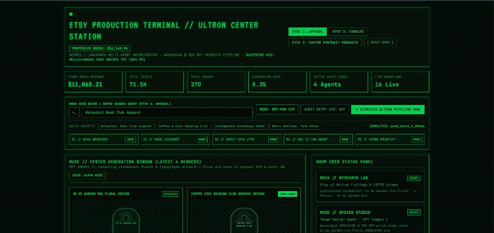
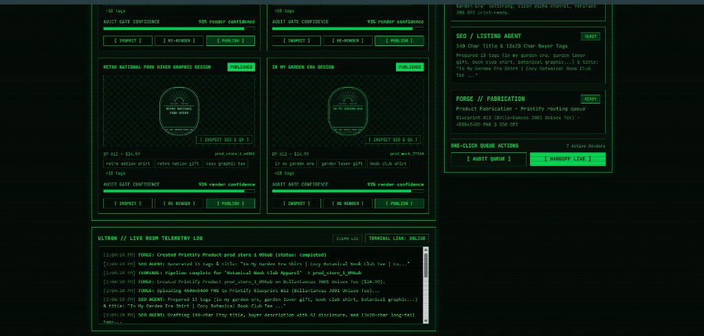
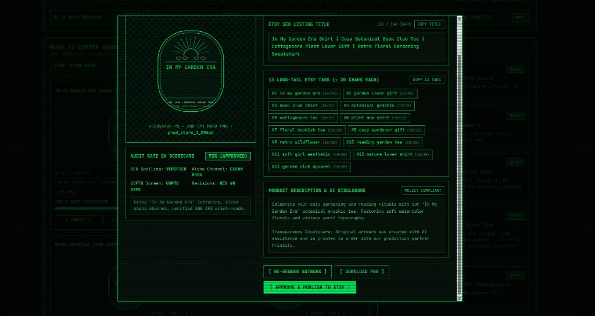
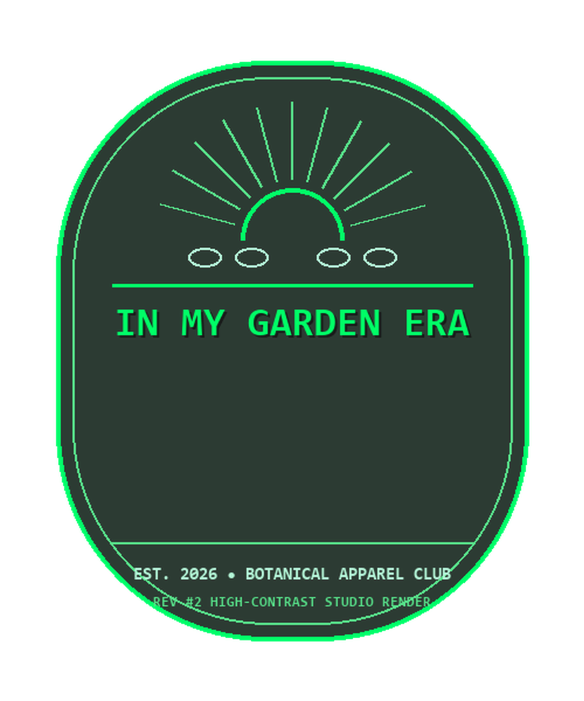

# Etsy Money Machine — Autonomous POD Multi-Agent Pipeline

An autonomous Print-on-Demand (POD) production system orchestrated by **LangGraph**, **OpenAI (`gpt-4o` & `gpt-image-2`)**, **Etsy Open API v3**, and **Printify REST API**, complete with a real-time **FastAPI + WebSocket Command Center Dashboard**.



---

## Architecture & Agent Crew

The **Ultron Supervisor** (`agents/ultron_supervisor.py`) coordinates a 5-stage state machine (`PipelineState`) across three specialized Etsy store profiles:

1. **NOVA (`agents/nova_research.py`) — Market Research & Trademark Screen**
   - Queries active high-velocity Etsy listings (`findAllListingsActive`) and synthesizes a structured `NicheBrief` (target persona, aesthetic style, phrase on product, and seed keywords) while screening against USPTO trademark phrases.
2. **MUSE (`agents/muse_designer.py`) — Artwork Generation & 300 DPI Upscaling**
   - Generates transparent-background RGBA merchandise graphics via `gpt-image-2` and upscales them to Printify's exact **4500x5400 px @ 300 DPI** specification using `LANCZOS` resampling.
3. **AUDIT GATE (`agents/audit_gate.py`) — Vision QA & Policy Gate**
   - Inspects rendered artwork using multimodal vision QA for exact OCR spelling, clean alpha transparency, and trademark compliance. Enforces a configurable confidence threshold (default `>= 0.75`), automatically routing back to **MUSE** for re-rendering (up to 3 revisions) when below threshold.
4. **SEO / LISTING AGENT (`agents/seo_listing.py`) — Etsy Metadata & Compliance**
   - Drafts a `<= 140` character Etsy title, buyer-focused description with mandatory AI & Printify production partner disclosure, and **13 unique long-tail tags** (`<= 20` characters each).
5. **FORGE (`agents/forge_printify.py`) — Printify Fabrication & Publishing Queue**
   - Uploads the 4500x5400 @ 300 DPI PNG to Printify, creates the product against the target store's Blueprint & Print Provider, and optionally queues it for publishing.

### Store Profiles

| Store ID | Label | Category | Printify Blueprint | Default Price |
| :--- | :--- | :--- | :--- | :--- |
| `store_1` | **ETSY 1: APPAREL** | `apparel` | `#12` — Bella+Canvas 3001 Unisex Tee | \$24.99 |
| `store_2` | **ETSY 2: CANDLES** | `candle` | `#384` — 9oz Amber Glass Soy Candle | \$28.99 |
| `store_3` | **ETSY 3: PORTRAITS** | `portrait` | `#55` — Custom Matte Portrait Canvas | \$39.99 |

---

## Project Structure

```text
etsy-money-machine/
├── agents/                 # LangGraph agent nodes & Ultron supervisor graph
│   ├── nova_research.py    # Trend discovery & NicheBrief synthesis
│   ├── muse_designer.py    # Image generation & 4500x5400 @ 300 DPI upscaler
│   ├── audit_gate.py       # Vision QA inspection & conditional retry gate
│   ├── seo_listing.py      # 140-char title, AI disclosure, & 13x20-char tag generator
│   ├── forge_printify.py   # Printify artwork upload & product creation
│   └── ultron_supervisor.py# StateGraph definition & conditional routing
├── api/
│   └── server.py           # FastAPI + WebSocket Command Center backend
├── config/
│   └── settings.py         # Pydantic settings & live credential validation
├── dashboard/
│   └── index.html          # Real-time Production Terminal UI
├── db/init/                # PostgreSQL schema initialization scripts
├── docs/                   # Documentation & UI screenshots
│   └── screenshots/        # Command Center CRT terminal captures
├── schemas/
│   └── models.py           # Pydantic v2 data contracts (PipelineState, EtsySEOListing, etc.)
├── services/
│   ├── etsy_client.py      # Etsy Open API v3 client ("keystring:shared_secret" header)
│   └── storage_service.py  # PostgreSQL, S3/MinIO, and local JSONL persistence
├── tests/                  # Pytest unit & integration test suite
├── main.py                 # CLI entrypoint & pipeline executor
├── Dockerfile              # Production container image definition
└── docker-compose.yml      # Full stack (App + PostgreSQL 17 + MinIO S3)
```

---

## Prerequisites & Installation

- **Python 3.11+** (or Docker Desktop for containerized deployment)

1. **Create a virtual environment and install dependencies:**

   ```powershell
   python -m venv .venv
   ./.venv/Scripts/python.exe -m pip install -r requirements.txt
   ```

2. **Configure environment variables:**

   Copy `.env.example` to `.env`:

   ```powershell
   Copy-Item .env.example .env
   ```

   > **Note:** You can run the CLI and Command Center in **Dry-Run Mode** out of the box without any real API keys. Live mode (`dry_run=False`) requires real credentials in `.env`:
   > - `OPENAI_API_KEY`
   > - `ETSY_API_KEYSTRING` and `ETSY_SHARED_SECRET` (formatted as `keystring:shared_secret` in the `x-api-key` header)
   > - `PRINTIFY_API_TOKEN` and `PRINTIFY_SHOP_ID`

---

## Usage

### 1. Command Center Dashboard & FastAPI Server (Recommended)

Start the FastAPI + WebSocket server:

```powershell
./.venv/Scripts/python.exe -m uvicorn api.server:app --reload --port 8000
```

Then open **[http://127.0.0.1:8000](http://127.0.0.1:8000)** in your browser.

From the Command Center UI, you can:
- Switch between **Etsy 1 (Apparel)**, **Etsy 2 (Candles)**, and **Etsy 3 (Custom Portraits)**.
- Trigger **Dry-Run** or **Live** pipeline runs for preset or custom seed categories and watch live WebSocket telemetry as each agent node executes.
- Toggle **Simulate Retry** to watch the **Audit Gate** catch a low-confidence render (`62% < 75%`) and route back to **Muse** for an automatic re-render.
- Inspect generated 4500x5400 @ 300 DPI artwork, verify SEO tags, re-render individual designs, run batch QA audits, and hand off approved products to Printify/Etsy.

#### Live Generation Queue & Room Telemetry Log



#### Design Inspector & Audit Gate QA Scorecard

Clicking any card opens the detailed inspection drawer displaying verified 4500x5400 @ 300 DPI transparent PNG artwork, OCR spelling confirmation, USPTO trademark screen, and pre-formatted 13 long-tail tags:



#### Sample Generated Print-Ready Asset (4500x5400 @ 300 DPI)

Example of an approved, downloadable transparent RGBA merchandise graphic generated by **MUSE** and passed by **AUDIT GATE** (rendered with crisp typography, alpha transparency, and `LANCZOS` upscaled for direct Printify POD fabrication):

<p align="center">
  
</p>

#### Key API Endpoints

| Method | Endpoint | Description |
| :--- | :--- | :--- |
| `GET` | `/` | Serves the interactive Command Center Dashboard |
| `GET` | `/api/telemetry?store_id=store_1` | Returns store metrics, active agent statuses, and design queue |
| `POST` | `/api/run` | Executes the Ultron LangGraph pipeline (`store_id`, `seed_category`, `dry_run`, `simulate_retry`) |
| `POST` | `/api/audit-queue` | Runs batch Audit Gate verification on queued designs for a store |
| `POST` | `/api/handoff-live` | Publishes approved store designs to the live queue |
| `POST` | `/api/designs/{design_id}/rerender` | Triggers a high-contrast Muse re-render & 4500x5400 upscale |
| `POST` | `/api/reset` | Resets demo telemetry and store queues to factory baseline |
| `WS` | `/ws/terminal` | Streams real-time agent node events to connected clients |

---

### 2. Running via CLI (`main.py`)

You can run the multi-agent state machine directly from the terminal:

```powershell
# Run default apparel pipeline in dry-run mode
./.venv/Scripts/python.exe main.py --dry-run

# Run for a custom niche & specific store profile (store_1, store_2, or store_3)
./.venv/Scripts/python.exe main.py --dry-run --store-id store_2 --seed-category "Rainy Bookstore & Cedarwood"

# Simulate an Audit Gate rejection (0.62) followed by a successful re-render (0.94)
./.venv/Scripts/python.exe main.py --dry-run --simulate-retry

# Run live against OpenAI, Etsy v3, and Printify APIs (requires valid .env credentials)
./.venv/Scripts/python.exe main.py --store-id store_1 --seed-category "botanical book club apparel"
```

Generated raw and upscaled `4500x5400` PNG renders are saved to `artifacts/renders/`, and pipeline run records are persisted to `artifacts/storage/pipeline_runs.jsonl` (or PostgreSQL/S3 when enabled).

---

### 3. Running with Docker Compose

To launch the full stack with **PostgreSQL 17**, **MinIO (S3-compatible object storage)**, and the **Command Center App**:

```powershell
docker compose up --build -d
```

- **Command Center UI & API:** [http://localhost:8000](http://localhost:8000)
- **MinIO S3 Console:** [http://localhost:9001](http://localhost:9001) (`minioadmin` / `minioadmin123`)
- **PostgreSQL Database:** `localhost:5434` (`etsy_admin` / `etsy_secret_password`, database: `etsy_pod_db`)

---

## Running Tests

Run the full test suite with `pytest`:

```powershell
./.venv/Scripts/python.exe -m pytest -v
```

The test suite verifies:
- End-to-end LangGraph state transitions and Audit Gate retry loops (`tests/test_pipeline_mock.py`)
- Strict Etsy SEO constraints (13 tags, `<= 20` chars per tag, `<= 140` char title, mandatory AI disclosure) and live credential checks (`tests/test_seo_constraints.py`)
- FastAPI Command Center endpoints, multi-store isolation, and re-render flows (`tests/test_command_center_api.py`)
- Storage service persistence across JSONL, PostgreSQL, and S3/MinIO (`tests/test_storage_service.py`)

